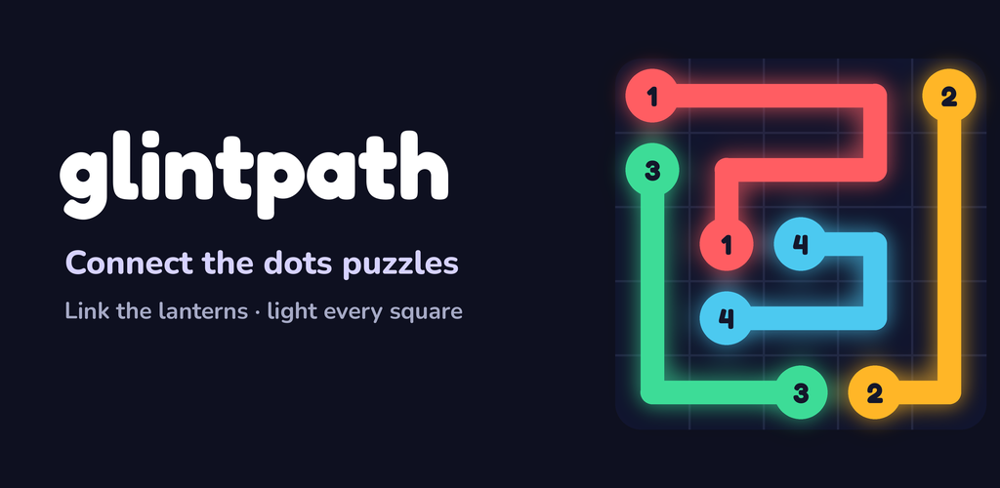
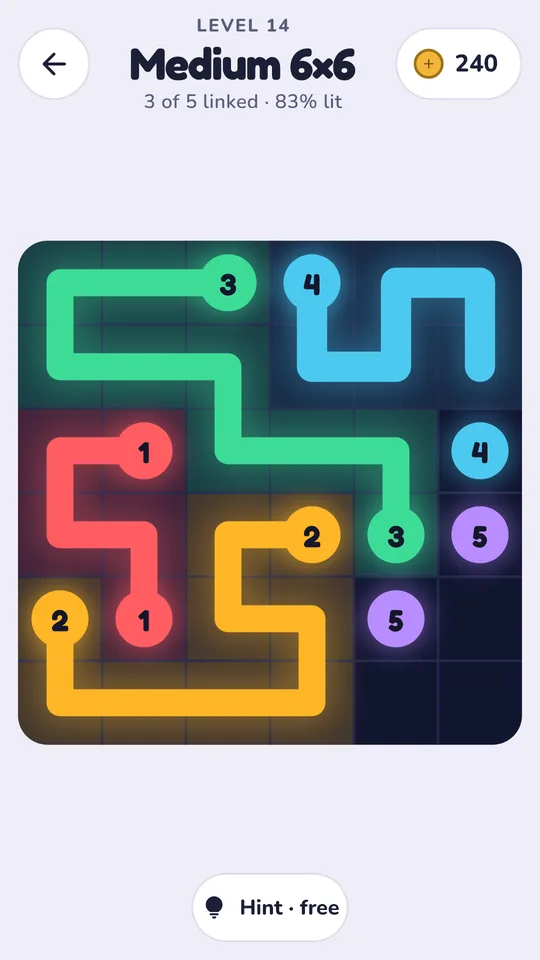
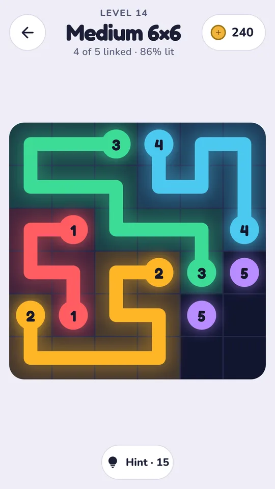
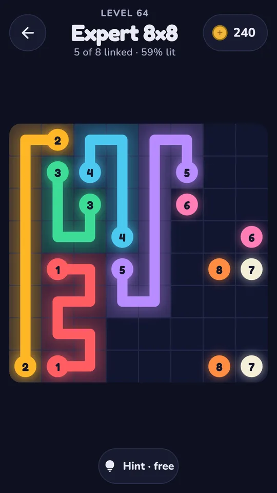
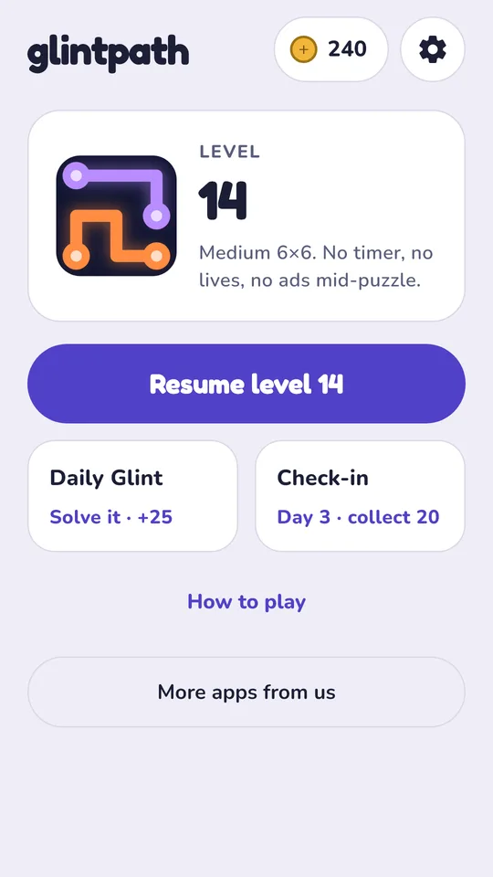

# Glintpath: Connect Dots Puzzle

A free connect the dots puzzle for Android on a night-sky board. Drag from a glowing lantern to its twin of the same colour and number, never cross paths, and light every square. Every board can be solved, with no timer, no lives and no ads during a board.

<a href="https://play.google.com/store/apps/details?id=com.nktools.glintpath&utm_source=github&utm_medium=readme"><b>Get it on Google Play</b></a> · <a href="https://glintpath.pages.dev/">Website</a> · <a href="https://nookeshkarri7.github.io/glintpath-connect-dots/">About page</a>

## How it plays

- **Link the lanterns.** Drag from a lantern to its twin, square by square, up, down, left or right.
- **Light every square.** Paths can't cross; a board is solved when every pair is linked and every square is lit.
- **Always solvable.** Every board is built from a full answer, and any full answer you find counts.
- **Draw like a pencil.** Drag back to shorten a path, pick one up from the middle, or cut across another (back off and it returns).
- **Numbered lanterns.** Matching lanterns share a number, so you never need to tell colours apart.
- **Easy to Master.** 5×5 boards up to 9×9, plus a Daily Glint every day.
- **Hints.** A hint lays one pair along its answer; the first hint on every board is free.
- **Plays offline.** No Wi-Fi, no account. Light and dark themes.

Free, no purchases. Supported by optional videos and an occasional ad between boards, never during one.

## Links

- Google Play: https://play.google.com/store/apps/details?id=com.nktools.glintpath
- Website: https://glintpath.pages.dev/
- Privacy policy: https://glintpath.pages.dev/privacy/
- Teaser: https://youtu.be/8Y-7bU1m4js

© 2026 NK Tools
